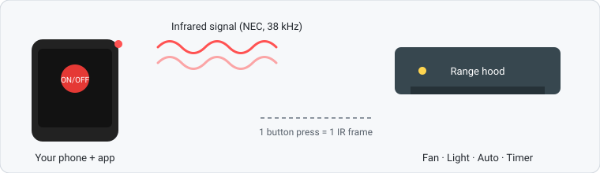
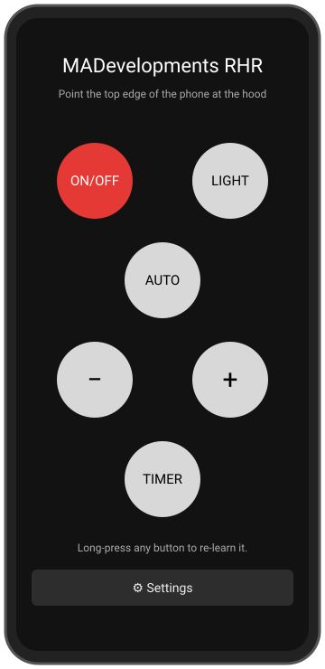
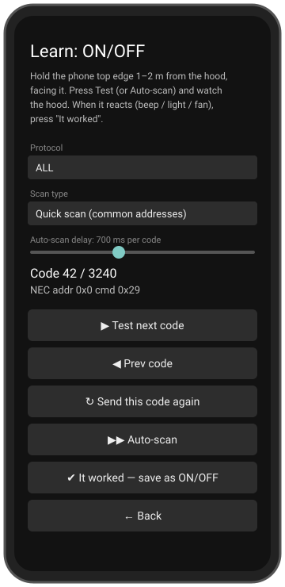
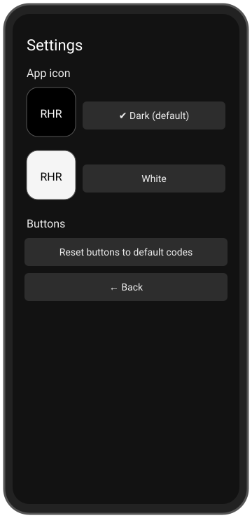

# 📡 MADevelopments RangeHood Remote Control

**Lost or broken the remote of your range hood? Your phone can be the remote.**

This is a free, personal Android app that turns your phone's built-in **infrared (IR) blaster** into a working remote for a **Golden MOD 3004 90 BL** range hood (90 cm, black, made in Turkey). It also includes a **Learn mode**, so it can be taught the buttons of other IR-controlled hoods.

---

## ✨ What it does for you

| Problem | How the app helps |
|---|---|
| The original remote is dead, lost or broken | The phone sends the same IR signals as the original remote |
| Replacement remotes are expensive or hard to find | No extra hardware needed, just a phone with an IR blaster |
| You don't know which code your hood uses | **Learn mode** tries codes one by one until the hood reacts, then saves the working code |
| A button doesn't work on your hood model | Long-press that button and re-learn it in a minute |
| You want to start over | **Reset buttons to default codes** restores the built-in codes |

## 📱 Screens

  
  &nbsp;&nbsp;
  
  &nbsp;&nbsp;
  

<i>Illustrations of the Remote, Learn and Settings screens. Replace them with real screenshots if you like (see "Add real screenshots" at the bottom).</i>

### 1. Remote screen
The main screen looks like a real remote:

- **ON/OFF** (red): turns the hood on or off
- **💡 Light**: switches the hood light
- **AUTO**: automatic mode
- **− / +**: fan slower / faster
- **⏱ Timer**: timer button (code not found yet for this hood, so tap it to learn it)

Tap a button to send its signal. Your phone gives a small vibration when it is sent. **Long-press any button** to open Learn mode for it.

### 2. Learn screen
If a button does nothing, or your hood is a different model, the app can search for the right code:

1. Hold the top edge of the phone **1–2 m** from the hood, facing it.
2. Choose a protocol (or **ALL**), a scan type (**Quick** for common addresses, **Full** for every address) and optionally a hex address.
3. Press **▶ Test next code** to try codes one at a time, or **▶▶ Auto-scan** to run through them automatically. The speed is adjustable, from 200 to 1600 ms per code.
4. Watch the hood. When it **beeps, lights up or the fan changes**, press **✔ It worked: save as ...**
5. If Auto-scan went past the right code, press **■ Stop** and use **◀ Prev code** until the hood reacts again. **↻ Send this code again** repeats the current code.

Once the power code is known, the app reuses its protocol and address when you learn other buttons, so only the commands are scanned. That makes learning the other buttons much faster.

### 3. Settings
- Choose the **app icon**: Dark (default) or White
- **Reset buttons to default codes**: deletes your saved codes

## 🚀 How to use it (quick start)

1. Install the APK on a phone **with an IR blaster** (see "Install" below).
2. Open the app and point the **top edge of the phone** at the hood.
3. Tap a button. If the hood reacts, you're done.
4. If it doesn't, long-press the button and use Learn mode.

## 🔢 Codes found for this hood

All codes use the **NEC** protocol with address `0x00`.

| Button | Command |
|---|---|
| ON/OFF | `0x45` |
| Light | `0x47` |
| Fan − | `0x07` |
| Fan + | `0x09` |
| AUTO | `0x40` |
| Timer | not found yet (use Learn mode) |

Protocols the Learn mode can scan: **NEC, NEC-Extended, Samsung, Sony 12-bit, RC5**.

## ✅ Requirements

- An Android phone with an **IR blaster** (Android 11 or newer)
- A hood that uses an **infrared** remote. RF (radio) remotes will not work

> Not sure your phone has an IR blaster? Open the app. If it says "⚠ No IR blaster found", the phone can't send IR signals.

## 📥 Install

No Android Studio is needed. GitHub builds the APK for you:

1. Open the **Actions** tab and select the latest **Build APK** run (or click **Run workflow**).
2. When the run is green, download **MADevelopments-apk** from the **Artifacts** section.
3. Unzip it and install `MADevelopments_RangeHoodRemoteControl.apk` on the phone. You may need to allow "Install unknown apps".

### Optional: sign the APK with your own key
Add these repository secrets (Settings → Secrets and variables → Actions) and the build will sign the APK with your key instead of the debug key:
`KEYSTORE_BASE64`, `KEYSTORE_PASSWORD`, `KEY_ALIAS`, `KEY_PASSWORD`.

## 💡 Tips

- Each command is sent as **a single frame**, because the hood treats repeated frames as extra button presses.
- Keep the phone's IR window (usually the top edge) aimed at the hood's receiver.
- Learn mode works best in a quiet kitchen where you can hear the hood beep.

## 🗂 Project layout

- `app/src/main/java/com/hood/remote/Ir.kt`: IR protocol encoders and the code scanner list
- `app/src/main/java/com/hood/remote/MainActivity.kt`: remote, learn and settings screens
- `.github/workflows/build.yml`: cloud build
- `docs/images/`: README illustrations

## 🖼 Add real screenshots

1. Take screenshots on your phone and save them as `remote.png`, `learn.png` and `settings.png`.
2. Upload them into the `docs/images/` folder on GitHub.
3. In this README, change `remote-screen.svg` to `remote.png` (and the same for the other two).

## ⚠️ Disclaimer

A personal hobby project, not affiliated with Golden or any hood manufacturer. Use at your own risk.

---
Made by **MADevelopments**
